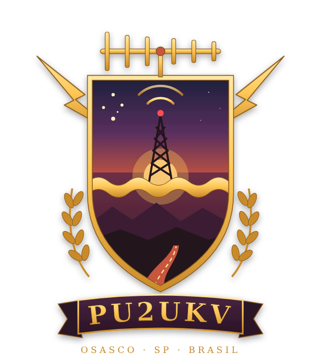

---
hide:
  - toc
  - navigation
---

Caderneta de campo
Radioamadorismo · Overland · Camping

Rádio, estrada e acampamento — referência rápida para usar no meio do QSO ou na beira da trilha.

[Repetidoras da região](radioamador/repetidoras.md){ .md-button .md-button--primary }
[Código Q](radioamador/codigo-q.md){ .md-button }

# O que tem aqui

<a class="card" href="radioamador/codigo-q/">
<strong>:material-format-list-bulleted: Código Q</strong>
Os códigos usados de verdade na faixa, com significado.
</a>

<a class="card" href="radioamador/alfabeto-fonetico/">
<strong>:material-alphabetical-variant: Alfabeto fonético</strong>
ITU/ICAO com pronúncia e Morse, letras e números.
</a>

<a class="card" href="radioamador/repetidoras/">
<strong>:material-radio-tower: Repetidoras</strong>
Escolha a região ou use o GPS — as mais próximas primeiro.
</a>

<a class="card" href="radioamador/programar-ht/">
<strong>:material-cellphone-cog: Programar o HT</strong>
Frequência, offset e tom — sem complicação.
</a>

<a class="card" href="overland/radio-em-trilha/">
<strong>:material-car: Rádio em trilha</strong>
Comunicação em comboio e em área sem celular.
</a>

<a class="card" href="overland/checklist-4x4/">
<strong>:material-clipboard-check-outline: Checklist 4x4</strong>
O que revisar e levar antes de pegar a estrada.
</a>

<a class="card" href="camping/campings/">
<strong>:material-tent: Campings próximos</strong>
Mapa com os campings perto de você, com rota pelo Google Maps.
</a>

<a class="card" href="radioamador/indicativos/">
<strong>:material-card-account-details-outline: Consulta de indicativos</strong>
Classe, estado e perfis do operador a partir do indicativo.
</a>

<a class="card" href="radioamador/emergencia/">
<strong>:material-alarm-light-outline: Frequências de emergência</strong>
Onde escutar e chamar quando o celular cai — VHF, HF, PX e mais.
</a>

## Últimos roteiros

<a class="card card-foto" href="overland/roteiros/serra-da-canastra/">

<strong>:material-car-lifted-pickup: Serra da Canastra · MG</strong>
Serra Branca, Caminho do Céu e a nascente do São Francisco.
</a>

<a class="card card-foto" href="overland/roteiros/serra-do-corvo-branco/">

<strong>:material-image-filter-hdr: Serra do Corvo Branco · SC</strong>
O maior corte de rocha do Brasil e o espectro de Brocken.
</a>

<a class="card card-foto" href="overland/roteiros/serra-do-rio-do-rastro/">

<strong>:material-road-variant: Serra do Rio do Rastro · SC</strong>
284 curvas da SC-390 até ≈ 1.460 m.
</a>

[Todos os roteiros e o mapa :material-arrow-right:](overland/roteiros/index.md){ .md-button }

!!! tip "Use no celular"
    O site funciona bem no telefone e tem busca no topo — digite `QTH`, `Campinas` ou `123.0` e vá direto ao ponto.

**73 & bons QSOs!**
