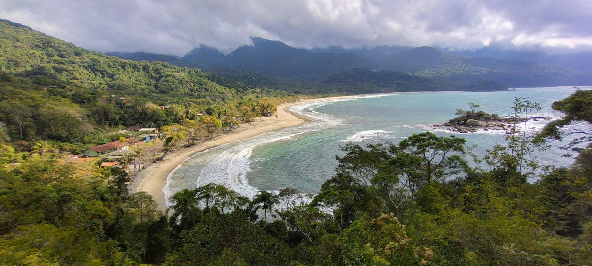
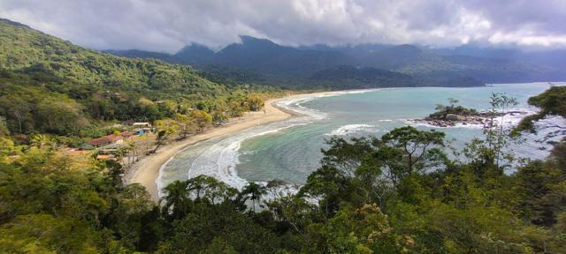
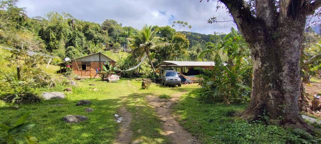
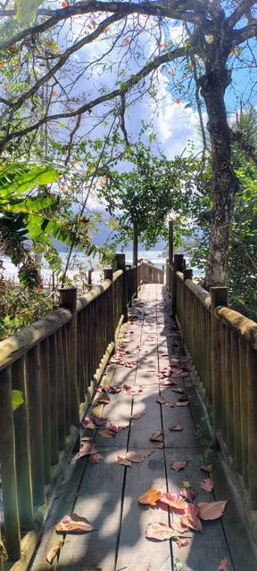
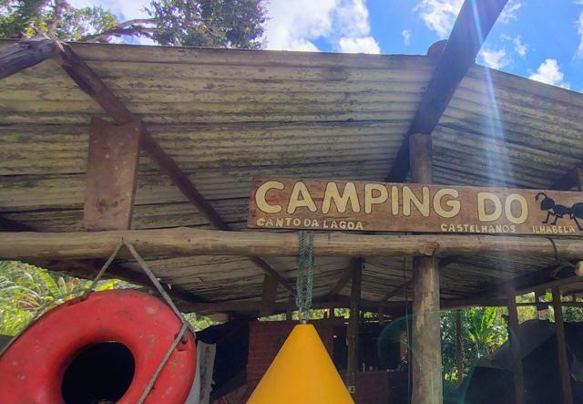
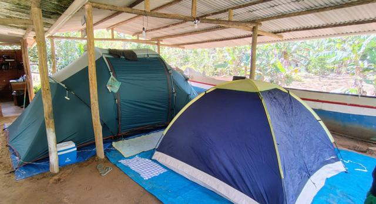

# Castelhanos · Ilhabela/SP — Estrada-Parque e Camping do Formiga

{ .capa-roteiro }

Atravessar Ilhabela de um lado ao outro por uma estrada de terra no meio da Mata Atlântica, descer até uma baía em forma de coração voltada para o mar aberto e acampar no **Camping do Formiga**, no Canto da Lagoa. É o roteiro mais completo do site até agora: **4x4 de verdade, camping raiz e uma área sem celular** — onde o rádio deixa de ser hobby e vira equipamento de segurança.

| | |
|---|---|
| **Destino** | Praia de Castelhanos · Canto da Lagoa — Ilhabela/SP |
| **Distância de Osasco** | ≈ 157 km em linha reta · balsa São Sebastião ↔ Ilhabela |
| **Estrada-Parque** | ≈ 17 km de terra dentro do Parque Estadual de Ilhabela, saindo do Perequê |
| **Veículo** | **Somente 4x4**, com autorização prévia do Parque · máx. 30 km/h |
| **Horário (subida)** | Perequê → Castelhanos: 7h às 14h |
| **Horário (volta)** | Castelhanos → Perequê: a partir das 15h (fontes citam 18h ou 19h como limite — confirme) |
| **Limite diário** | 42 carros particulares · 60 motos · 65 jipes de turismo |
| **Celular** | **Some logo no começo da estrada** — leve dinheiro em espécie |
| **Melhor época** | Estação seca, de maio a agosto |

!!! danger "A estrada fecha com chuva"
    A Estrada-Parque é interditada sempre que chove forte — em 2026 ela ficou fechada por semanas entre janeiro e março e foi liberada em 2 de março. **Confira a situação com o Parque Estadual de Ilhabela e a Defesa Civil antes de sair de casa**, e não tente passar em dia de chuva.

## A estrada

A Estrada-Parque de Castelhanos cruza a ilha de oeste para leste, subindo a serra pela mata e descendo do outro lado até a baía. É estreita, com trechos de pedra, barro e erosão — por isso a regra de **mão única por horário**: de manhã só se sobe, à tarde só se volta.

**Autorização:** carros particulares precisam reservar a vaga com o Parque Estadual pelo sistema oficial de ingressos dos parques paulistas (o link está nas referências). Ao chegar à praia há **taxa de estacionamento** obrigatória.

## Camping do Formiga — Canto da Lagoa

O Camping do Formiga fica no **Canto da Lagoa**, em Castelhanos. É camping raiz, de praia isolada:

- **Área de barracas coberta** por um telhado de telhas — salva o acampamento em noite de chuva e no sol forte do meio-dia.
- **Cozinha coletiva** de alvenaria, com fogão e prateleiras.
- Terreno gramado no meio do bananal e da mata, com espaço para estacionar o 4x4 perto da barraca.
- Uma **passarela de madeira** leva da área do camping até a praia.

!!! tip "Combine antes"
    Não há celular na praia. Reserve e combine tudo (datas, valores, o que levar) **antes** de descer a serra.

## Plano de comunicação

Castelhanos é a primeira área **realmente sem cobertura** dos roteiros do site: sem celular e, na praia, **cercada pela serra da ilha** de um lado e pelo mar aberto do outro. Não há repetidora de radioamador na própria ilha nas bases consultadas.

### 1. Na Estrada-Parque — comboio em simplex

- Estrada estreita, de mão única e com curvas fechadas: o simplex entre os carros é **o principal canal**. Combine a frequência antes da balsa.
- **Avise pelo rádio** os pontos críticos: atoleiro, pedra solta, trecho de erosão, carro parado.
- Mantenha **contato visual ou de rádio** com o carro de trás; se sumir do rádio, pare no próximo ponto seguro e espere.

### 2. Apoio — repetidoras (do continente)

A distância e a serra da ilha atrapalham. Estas são as mais próximas na base do site — **chances só nos pontos altos da estrada**, e nada garantido:

| Saída (RX) | Offset | Tom | Repetidora | Indicativo | Dist. de Castelhanos |
|---|---|---|---|---|---|
| **439.100** | −5 | CTCSS 123.0 | Ubatuba | `PY2KDY` | ≈ 53 km · norte |
| **145.450** | −0,6 | CTCSS 67.0 | Paraibuna (Tamoios) | `PY2KCR` | ≈ 64 km · noroeste |
| **145.230** | −0,6 | CTCSS 88.5 | Paraty/RJ | `PY1MBU` | ≈ 93 km · nordeste |

!!! tip "Use a 145.450 na viagem"
    A repetidora de **Paraibuna** fica no caminho da **Rodovia dos Tamoios** — ótima companhia de rádio na descida para o litoral, até a serra começar a bloquear.

### 3. Emergência sem celular

1. **Antes de descer:** deixe o roteiro e o horário de volta com alguém que fica no continente.
2. Na praia, quem sobe e desce todo dia são os **jipeiros credenciados e os barqueiros** — em emergência, eles são o caminho mais rápido de contato com o continente.
3. Pelo rádio, tente as repetidoras acima **a partir do ponto mais alto da estrada**, não da praia.
4. Saiba onde está: anote referências (Canto da Lagoa, Canto do Ribeirão, praia, estrada).

!!! example "Ideia para os próximos acampamentos"
    É o lugar perfeito para testar **rede mesh LoRa (Meshtastic/MeshCore)** e **APRS**: um nó no camping e outro no alto da estrada já cobririam o grupo. Fica o desafio registrado para a próxima viagem.

## Teste de rádio

| Ponto | Repetidora / contato | Abriu? | Observação |
|---|---|---|---|
| Rodovia dos Tamoios | 145.450 Paraibuna | — | *a registrar* |
| Balsa (São Sebastião) | 439.100 Ubatuba | — | *a registrar* |
| Alto da Estrada-Parque | 439.100 / 145.450 | — | *a registrar* |
| Camping (Canto da Lagoa) | Simplex entre barracas e carro | — | *a registrar* |

## Antes de ir

- [ ] **Reserva do veículo** no sistema do Parque Estadual (vaga limitada a 42 carros/dia)
- [ ] **Previsão do tempo e situação da estrada** — com chuva, não vá
- [ ] Reserva no camping combinada antes (sem celular lá embaixo)
- [ ] **Dinheiro em espécie** (cartão não é garantido)
- [ ] Horários da balsa e tempo de fila (alta temporada pode demorar horas)
- [ ] Tanque cheio no continente ou em Ilhabela, antes da estrada
- [ ] Kit de recuperação: cinta, manilhas, pá, compressor
- [ ] Rádio com memórias programadas e bateria/alimentação pelo carro
- [ ] Repelente — na mata, o borrachudo não perdoa

## Galeria

*Toque em uma foto para ver em tamanho grande.*

## Referências

- [Prefeitura de Ilhabela — como visitar Castelhanos (regras da Estrada-Parque)](https://www.ilhabela.sp.gov.br/portal/noticias/0/3/15693/praia-do-coracao-em-ilhabela-como-visitar-castelhanos)
- [Reserva de veículos — Estrada-Parque Castelhanos (Parques Paulistas)](https://ilhabela.ingressosparquespaulistas.com.br/produto/ff-ilhabela-estrada-parque-castelhanos-carros-particulares?divisao=0)
- [Notícias das Praias — Estrada-Parque liberada (mar/2026)](https://noticiasdaspraias.com/2026/03/03/estrada-parque-de-castelhanos-em-ilhabela-foi-liberada-ao-trafego/)
- [Hostel da Vila — guia de Castelhanos (jul/2026)](https://hosteldavila.com.br/guia-de-experiencias/ilhabela/praia-de-castelhanos)
