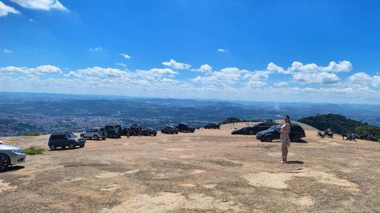
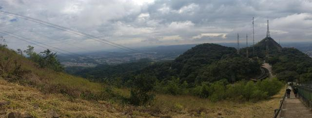
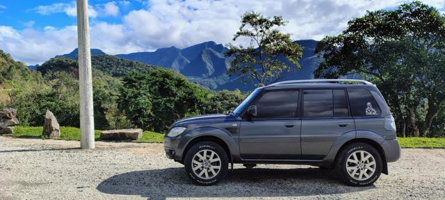
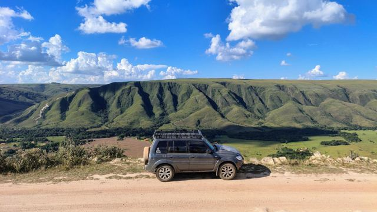

# Roteiros

Roteiros perto de casa e viagens mais longas — de carro ou a pé — sempre com **plano de comunicação**: frequência do comboio, repetidoras de apoio e o que realmente funciona no rádio em cada ponto.

<a class="card card-foto" href="trilha-da-placa/">

<strong>:material-flag-checkered: Trilha da Placa · Cajamar</strong>
Off-road até o ponto mais alto de Cajamar (≈ 1.083 m). Nível médio, ≈ 23 km de Osasco.
</a>

<a class="card card-foto" href="pedra-grande/">

<strong>:material-image-filter-hdr: Pedra Grande · Atibaia</strong>
Platô de granito a ≈ 1.418 m, acesso de carro. O ponto alto para testar alcance de rádio.
</a>

<a class="card card-foto" href="pico-do-jaragua/">

<strong>:material-hiking: Pico do Jaraguá · São Paulo</strong>
Trilha a pé até o ponto mais alto da capital (≈ 1.135 m), ao lado das torres de TV.
</a>

<a class="card card-foto" href="castelhanos/">

<strong>:material-tent: Castelhanos · Ilhabela</strong>
Estrada-Parque 4x4 até a baía em forma de coração e camping no Canto da Lagoa. Área sem celular.
</a>

<a class="card card-foto" href="serra-do-rio-do-rastro/">

<strong>:material-road-variant: Serra do Rio do Rastro · SC</strong>
284 curvas da SC-390 até ≈ 1.460 m, mirantes, camping e vídeo do alto da serra.
</a>

<a class="card card-foto" href="serra-do-corvo-branco/">

<strong>:material-image-filter-hdr: Serra do Corvo Branco · SC</strong>
O maior corte de rocha do Brasil, curvas de 180° e o espectro de Brocken. Em obras — confira antes.
</a>

<a class="card card-foto" href="serra-da-canastra/">

<strong>:material-car-lifted-pickup: Serra da Canastra · MG</strong>
Serra Branca, subida do Caminho do Céu, nascente do São Francisco e camping em São Roque de Minas.
</a>

*Mais roteiros em breve.*
