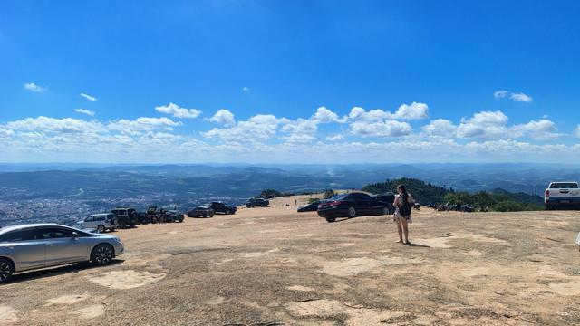
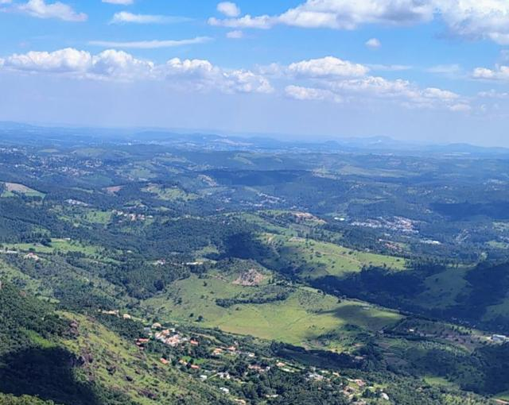
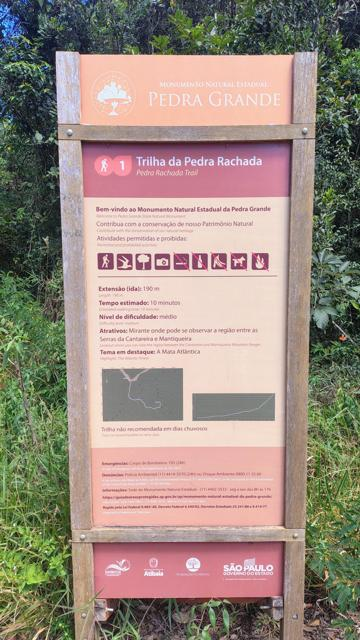

# Pedra Grande · Atibaia/SP

{ .capa-roteiro }

Um imenso platô de granito a **1.418 m de altitude**, na Serra do Itapetinga, com visão de 360° — e dá para chegar de carro até lá em cima. Para o radioamador, é um dos melhores pontos altos de fácil acesso perto da capital: **daqui a serra "enxerga" São Paulo, Jundiaí, Campinas e o Sul de Minas.**

| | |
|---|---|
| **Destino** | Platô da Pedra Grande — Monumento Natural Estadual, Atibaia/SP |
| **Altitude no topo** | ≈ 1.418 m |
| **Distância de Osasco** | ≈ 51 km em linha reta · ≈ 86 km de SP pela estrada |
| **Acesso** | Rodovia Fernão Dias ou Dom Pedro I → Estrada da Pedra Grande; trecho final em terra, sinuoso |
| **Nível** | Fácil a moderado no seco · com chuva, buracos e lama no trecho de terra |
| **Veículo** | 4x4 recomendado; no seco, carros comuns também sobem |
| **Entrada** | Gratuita, sem agendamento |
| **Horário** | Divulgado pela Fundação Florestal como 6h30–18h (confirme antes de ir) |

## O lugar

A Pedra Grande é um **Monumento Natural Estadual**, criado em 2010 e administrado pela **Fundação Florestal**, com cerca de 3.300 hectares entre Atibaia, Bom Jesus dos Perdões, Nazaré Paulista e Mairiporã. A rocha tem em torno de **600 milhões de anos**.

No topo, os carros estacionam direto sobre a laje de pedra. Dali saem a **Trilha da Pedra Rachada** (190 m, ≈ 10 min, nível médio), com mirante para a região entre a **Cantareira e a Mantiqueira**, e a rampa natural usada por **voo livre** (asa-delta e parapente).

!!! warning "Regras do Monumento"
    Proibido: animais domésticos, fogueira, lixo, camping e retirar plantas ou pedras. A Trilha da Pedra Rachada **não é recomendada em dias de chuva**.

## Plano de comunicação

Aqui o problema é o oposto da Trilha da Placa: no topo **o rádio vai longe demais**. A 1.418 m você abre muitas repetidoras ao mesmo tempo e pode **disparar várias de uma vez** — escolha uma e use **potência baixa**.

### 1. Comboio — simplex

- Na **subida pela estrada de terra** o simplex funciona bem entre carros próximos; nas curvas fechadas da serra pode falhar por alguns instantes.
- **No topo:** com os carros parados na laje, use **potência mínima** no simplex — o sinal alcança dezenas de quilômetros e pode atrapalhar outros grupos.

### 2. Apoio — repetidoras

Calculadas a partir do topo (linha reta):

| Saída (RX) | Offset | Tom | Repetidora | Indicativo | Dist. · rumo |
|---|---|---|---|---|---|
| **439.875** | −5 | CTCSS 123.0 | Nazaré Paulista | `PY2KEP` | 15 km · leste |
| **439.700** | −5 | CTCSS 67.0 | Mairiporã | `PY2APU` | 21 km · sul |
| **145.250** | −0,6 | CTCSS 123.0 | Mairiporã | `PY2LSP` | 21 km · sul |
| **147.270** | +0,6 | CTCSS 67.0 | Serra da Cantareira | `PY2KNF` | 30 km · sul |
| **147.030** | +0,6 | CTCSS 127.3 | Serra da Cantareira | `PY2APU` | 30 km · sul |
| **145.310** | −0,6 | CTCSS 103.5 | Joanópolis | `PY2KGV` | 36 km · nordeste |
| **146.870** | −0,6 | CTCSS 82.5 | Extrema/MG | `PY4FA` | 39 km · nordeste |

Lista completa: [Repetidoras da região](../../radioamador/repetidoras.md) — escolha **Bragança Paulista / Atibaia**.

### 3. Emergência

1. No platô, **celular costuma funcionar** — use junto com o rádio.
2. Pelo rádio: chame em **147.270 (Cantareira)** ou **439.700 (Mairiporã)**, com indicativo, **onde**, **o que aconteceu** e **quantas pessoas**.
3. Telefones úteis divulgados na placa do Monumento: **Bombeiros 193** · Polícia Ambiental (11) 4414-3570 · Sede do Monumento (11) 4402-3533.

## Dicas de rádio na região

### Para onde a serra "enxerga"

| Referência | Dist. · rumo | O que esperar |
|---|---|---|
| **Serra da Cantareira** | ≈ 33 km · Sul (≈ 195°) | O "corredor" para a capital; repetidoras altas e fortes |
| **[Pico do Jaraguá](pico-do-jaragua.md)** (SP) | ≈ 42 km · Sudoeste (≈ 215°) | Em dias limpos, visível a olho nu; repetidoras do lado de SP |
| **Osasco** | ≈ 51 km · Sudoeste (≈ 210°) | Bom desafio de simplex com a base em casa |
| **Alto da Placa** (Cajamar) | ≈ 39 km · Sudoeste (≈ 235°) | Ponto alto a ponto alto: ver desafio abaixo |
| **Bragança Paulista** | ≈ 21 km · Norte | Cidade logo abaixo, sinal fácil |
| **Extrema / Sul de Minas** | ≈ 39 km · Nordeste | Repetidoras de MG abrem bem daqui |
| **Serra da Mantiqueira** (Campos do Jordão) | ≈ 107 km · Nordeste | Distância grande: só com condições boas — vale o teste |

### Desafio: Placa ↔ Pedra Grande em simplex

Os dois roteiros deste site são pontos altos separados por **≈ 39 km**: Alto da Placa (≈ 1.083 m) e Pedra Grande (≈ 1.418 m). Com um carro em cada topo, antenas verticais no teto e 25–50 W, **o QSO em simplex é bem possível** — e é um ótimo teste de equipamento. Registre o resultado aqui.

### Boas práticas no alto

- **Potência baixa primeiro**, só aumente se não for ouvido.
- **Escute antes** — do alto você ouve muita gente; a frequência pode parecer livre e não estar.
- Identifique-se com o **indicativo** no início e no fim.
- **APRS:** no topo, faça um beacon em **145.570 MHz** e veja no aprs.fi por quais digipeaters e iGates ele passou — ótimo teste de cobertura.

!!! danger "Raios no topo"
    Platô de rocha exposto a 1.418 m: **com tempo fechado e trovoada, desça**. Não fique no alto com antena externa montada.

## Teste de rádio no topo

| Repetidora / contato | Abriu? | Sinal / observação |
|---|---|---|
| 147.270 Cantareira | — | *a registrar* |
| 439.700 Mairiporã | — | *a registrar* |
| 146.870 Extrema/MG | — | *a registrar* |
| Simplex com Osasco | — | *a registrar* |
| Simplex com Alto da Placa | — | *a registrar* |

## Antes de ir

- [ ] Previsão do tempo: **com chuva, o trecho de terra fica com buracos e lama**; e trovoada no platô é perigo real
- [ ] Vá cedo: o topo é bem movimentado nos fins de semana (≈ 70 mil visitantes por ano)
- [ ] Rádio programado com as repetidoras de apoio
- [ ] Água, protetor solar e boné: o platô de pedra **não tem sombra**
- [ ] Nada de animais domésticos — é proibido no Monumento

## Galeria

*Toque em uma foto para ver em tamanho grande.*

## Referências

- [Guia de Áreas Protegidas SP — MoNa Pedra Grande](https://guiadeareasprotegidas.sp.gov.br/ap/monumento-natural-estadual-da-pedra-grande/)
- [Gazeta SP — Pedra Grande: trilha, mirante e voo livre (mai/2026)](https://www.gazetasp.com.br/turismo/perto-de-sp-montanha-de-600-milhoes-de-anos-tem-trilha-voo-livre-e/)
