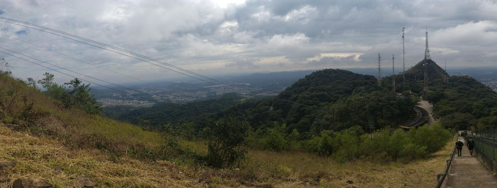
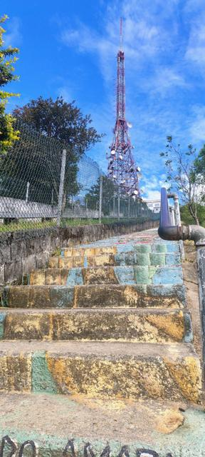
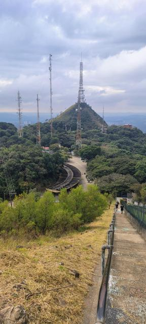
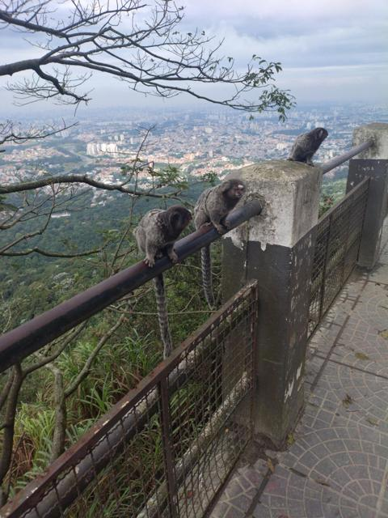
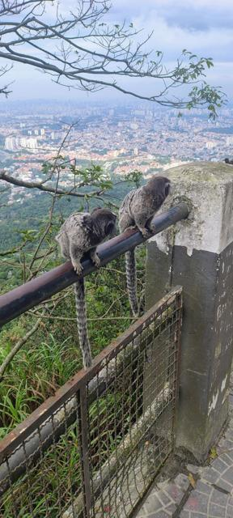

# Pico do Jaraguá · São Paulo/SP — trilha a pé

{ .capa-roteiro }

O **ponto mais alto da cidade de São Paulo**, a cerca de **1.135 m**, dentro do Parque Estadual do Jaraguá. Desta vez a TeRez4 fica no estacionamento: o roteiro é **a pé**, pela Trilha do Pai Zé, até a escadaria que termina ao lado das grandes torres de TV. Para o radioamador, é um lugar especial: **o pico é um dos grandes centros de antenas da Grande SP** — e isso muda como o seu rádio se comporta lá em cima.

| | |
|---|---|
| **Destino** | Pico do Jaraguá — Parque Estadual do Jaraguá, Zona Noroeste de SP |
| **Altitude no topo** | ≈ 1.135 m |
| **Distância de Osasco** | ≈ 8 km em linha reta |
| **Trilha** | Trilha do Pai Zé — ≈ 3,6 km pelos dados do parque (o AllTrails registra ≈ 5,5 km ida e volta, com ≈ 370 m de subida) |
| **Tempo** | ≈ 2h30 (ida e volta, no ritmo de caminhada) |
| **Nível** | Moderado a difícil — subida constante, chão de argila e pedras |
| **Entrada** | Gratuita · estacionamento gratuito no parque |
| **Horário** | Varia entre as fontes (em geral de terça a domingo, manhã até meio da tarde) — **confirme com a sede antes de ir** |

## O lugar

O Parque Estadual do Jaraguá foi criado em **1961** e foi reconhecido pela UNESCO em 1994 como parte da Reserva da Biosfera do Cinturão Verde de São Paulo. Além do pico, guarda a história do ouro paulista: o **casarão de Afonso Sardinha** e o antigo **tanque de lavagem de ouro**.

O parque tem outras trilhas curtas (Silêncio, Lago, Bica) e uma **estrada asfaltada até o alto** para quem não quer subir a pé. Quem vai pela Trilha do Pai Zé sai da parte baixa do parque, atravessa a Mata Atlântica e termina numa **escadaria de concreto** que leva ao mirante, colado na grande torre de transmissão.

!!! tip "Saguis no mirante"
    Os mirantes do topo costumam ter **saguis** — eles chegam bem perto. **Não dê comida**: faz mal a eles e os deixa agressivos com visitantes.

## A trilha

- **Primeira metade:** sombreada, dentro da mata, chão de **argila e pedras** — com chuva fica escorregadio.
- **Segunda metade:** pouca sombra e **sol forte** até o topo.
- **Final:** a escadaria. Curta, mas íngreme — vá no seu ritmo.
- Antes do pico há bancos e um ponto de lanches.

## Plano de comunicação (a pé)

Aqui não tem rádio de carro: é **HT na mão**. E o Jaraguá tem uma particularidade que todo radioamador precisa conhecer.

### O problema do Jaraguá: RF demais

O topo é um dos maiores **"parques de antenas"** da Grande SP: TV, FM, telefonia, enlaces de micro-ondas. Perto dessas torres o seu HT recebe sinais fortíssimos fora da faixa de radioamador, e isso causa:

- **Dessensibilização:** o rádio fica "surdo" — repetidoras que deveriam estar fortes simplesmente somem.
- **Intermodulação:** chiados, "vozes" de rádio FM e sinais fantasmas em frequências que deveriam estar livres.

!!! warning "Como contornar"
    - **Afaste-se das torres.** Às vezes descer 50–100 m pela trilha, saindo do "facho" das antenas, resolve tudo.
    - **Ligue o atenuador (ATT)** se o seu rádio tiver — reduz a sobrecarga de sinais fortes.
    - **Abaixe o volume e use o silenciador (squelch) mais alto**; não conclua que "a repetidora caiu" enquanto estiver colado na torre.
    - Rádios com filtro de entrada melhor sofrem menos. HTs baratos sofrem muito.

### Repetidoras de apoio

Calculadas a partir do topo (linha reta):

| Saída (RX) | Offset | Tom | Repetidora | Indicativo | Dist. |
|---|---|---|---|---|---|
| **439.050** | −5 | CTCSS 67.0 | Taipas · pé do Jaraguá | `PY2KRB` | 6 km |
| **439.650** | −5 | CTCSS 123.0 | Caieiras | `PY2KPE` | 11 km |
| **147.270** | +0,6 | CTCSS 67.0 | Serra da Cantareira | `PY2KNF` | 16 km |
| **147.030** | +0,6 | CTCSS 127.3 | Serra da Cantareira | `PY2APU` | 16 km |
| **439.325** | −5 | CTCSS 103.5 | Av. Paulista | `PY2UNO` | 16 km |
| **145.350** | −0,6 | CTCSS 67.0 | São Paulo | `PY2KBD` | 17 km |

Lista completa: [Repetidoras da região](../../radioamador/repetidoras.md) — escolha **São Paulo (Zona Norte)** ou **Osasco**.

### Emergência na trilha

1. No topo o **celular** costuma funcionar; dentro da mata pode falhar. Se tiver sinal, ligue **193 (Bombeiros)** primeiro.
2. Pelo rádio: chame na **439.050 (Taipas)** ou **147.270 (Cantareira)** — indicativo, **onde** (início, meio da mata, trecho aberto ou escadaria), **o que aconteceu** e **quantas pessoas**.
3. Sede do parque: (11) 3941-2162 · (11) 3945-4532.

## Dicas de rádio na região

### Para onde o pico "enxerga"

| Referência | Dist. · rumo | O que esperar |
|---|---|---|
| **Osasco** | ≈ 8 km · Sul (≈ 195°) | Simplex de HT para a base em casa é bem possível — teste! |
| **Serra da Cantareira** | ≈ 14 km · Leste (≈ 75°) | Visada aberta; repetidoras fortes |
| **Av. Paulista / Centro** | ≈ 16 km · Sudeste (≈ 135°) | Os prédios altos da capital ficam de frente |
| **Alto da Placa** (Cajamar) | ≈ 16 km · Noroeste (≈ 330°) | Outro roteiro do site: QSO ponto alto a ponto alto |
| **Jundiaí / Serra do Japi** | ≈ 32 km · Noroeste (≈ 340°) | Repetidoras do lado de Jundiaí |
| **Pedra Grande** (Atibaia) | ≈ 42 km · Nordeste (≈ 35°) | Em dias limpos se vê uma da outra; simplex é um bom desafio |

### Equipamento para subir a pé

- **HT com antena melhor que a original** (meia-onda ou "antena chicote"): é a maior diferença que você pode fazer.
- **Bateria extra** — no alto o rádio transmite e recebe o tempo todo.
- Memórias programadas **antes** de sair: na trilha, mão livre é para segurar no corrimão.
- **Pochete ou alça no peito** para o HT: no bolso da calça a antena fica colada no corpo e o sinal cai muito.

!!! example "Desafio dos três picos"
    Com o [Alto da Placa](trilha-da-placa.md) e a [Pedra Grande](pedra-grande.md), o Jaraguá forma um triângulo de pontos altos: **16 km** até a Placa, **42 km** até a Pedra Grande. Três estações, uma em cada topo, em simplex — quem topa?

## Teste de rádio no topo

| Repetidora / contato | Abriu? | Sinal / observação |
|---|---|---|
| 439.050 Taipas (colado na torre) | — | *a registrar* |
| 439.050 Taipas (100 m abaixo) | — | *a registrar* |
| 147.270 Cantareira | — | *a registrar* |
| Simplex com Osasco | — | *a registrar* |
| Simplex com Alto da Placa | — | *a registrar* |

## Antes de ir

- [ ] **Tênis com boa sola** — nada de chinelo; o chão de argila escorrega
- [ ] Água e um lanche · protetor solar e boné para a segunda metade, sem sombra
- [ ] Previsão do tempo: com chuva a trilha fica escorregadia; **com trovoada, não suba** — o topo é cheio de torres metálicas
- [ ] Confirme o horário do parque e chegue cedo
- [ ] HT carregado, bateria extra e memórias programadas

## Galeria

*Toque em uma foto para ver em tamanho grande.*

## Referências

- [São Paulo Secreto — o que fazer no Parque Estadual do Jaraguá (abr/2026)](https://saopaulosecreto.com/o-que-fazer-no-parque-estadual-do-jaragua/)
- [Pico do Jaraguá — Trilha do Pai Zé](https://picodojaragua.com/trilha-do-pai-ze/)
- [AllTrails — Trilha do Pai Zé](https://www.alltrails.com/trail/brazil/sao-paulo--2/trilha-do-pai-ze-pico-do-jaragua--2)
- [Wikiloc — Trilha do Pai Zé](https://www.wikiloc.com/hiking-trails/trilha-do-pai-ze-pico-do-jaragua-parque-estadual-jaragua-sao-paulo-sp-21476597)
