# Serra da Canastra · São Roque de Minas/MG

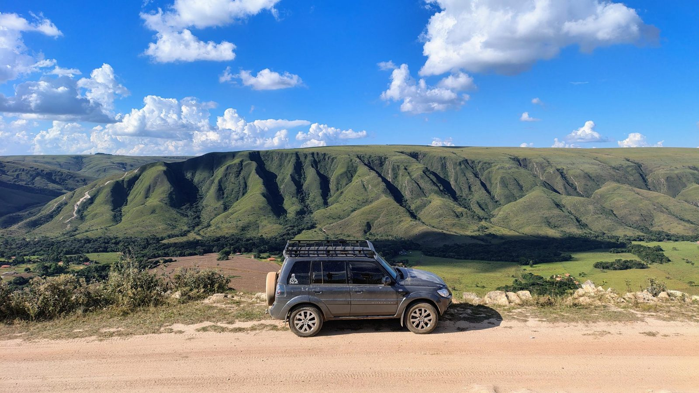{ .capa-roteiro }

A Canastra é um clássico do off-road brasileiro: chapadão de campos abertos, paredões que despencam em cachoeiras e estradas de cascalho branco com subidas de pedra solta. Montamos base num **camping em São Roque de Minas** e rodamos vários trechos com a TeRez4 — entre eles a **Serra Branca** e a **subida do Caminho do Céu**. Também passamos pela **nascente do Rio São Francisco**, pela **Cachoeira Rasga Canga** e pela vista da **Casca d'Anta**.

| | |
|---|---|
| **Base** | Camping em São Roque de Minas/MG |
| **Parque** | Parque Nacional da Serra da Canastra (ICMBio) |
| **Distância de Osasco** | ≈ 500 km de estrada (≈ 370 km em linha reta) |
| **Trechos 4x4** | Serra Branca · subida do Caminho do Céu · estradas do chapadão |
| **Nível** | Médio a difícil — pedra solta, erosão, subidas longas |
| **Celular** | Falha em boa parte do chapadão e das serras |
| **Destaques** | Nascente do São Francisco · Casca d'Anta (186 m) · Rasga Canga |

## Descendo a Serra Branca

<video class="video-roteiro video-vertical" controls muted loop playsinline preload="metadata" poster="../../../assets/img/canastra/comboio-poster.jpg">
  <source src="../../../assets/img/canastra/comboio.mp4" type="video/mp4">
</video>
*O comboio subindo pelo corte de pedra branca (vídeo sem som).*

## Os trechos 4x4

**Serra Branca** e **Caminho do Céu** são estradas de terra que ligam as regiões da serra (Bateia, Vale da Gurita, Serra Branca) e são procuradas por quem faz off-road e moto-trail. O roteiro clássico sai de **São José do Barreiro**, passa pela Casca d'Anta, Caminho do Céu e Serra Branca e chega a **Delfinópolis**, juntando erosão, pedras, travessia de rio, areia fofa — e lama, se chover.

Foi aqui que a TeRez4 foi **colocada à prova**:

- **Subidas longas de pedra solta**, em cortes de rocha branca — reduzida engatada, tração 4x4 e ritmo constante, sem parar no meio da rampa.
- **Erosões e degraus** — escolha de linha com calma, de preferência com alguém fora do carro orientando **pelo rádio**.
- **Descidas íngremes** — freio-motor em primeira reduzida, sem pisar no freio de forma brusca no cascalho.
- **Poeira** em comboio — distância maior entre os carros; com isso, o rádio vira o único jeito de avisar o que vem pela frente.

[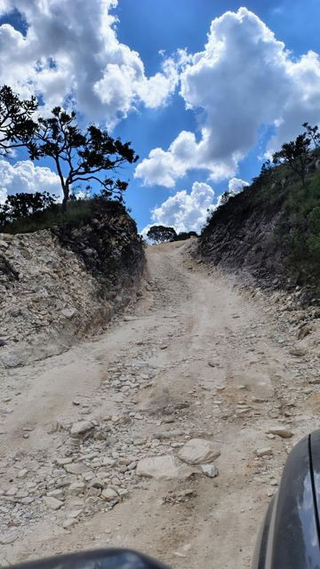](../../assets/img/canastra/04-subida-de-pedras.jpg "Subida de pedra solta")
[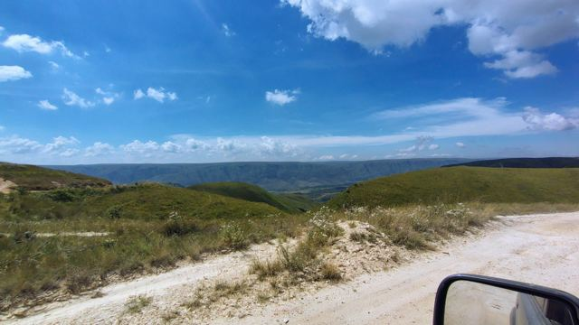](../../assets/img/canastra/11-estrada-branca.jpg "Estrada de cascalho branco no chapadão")
[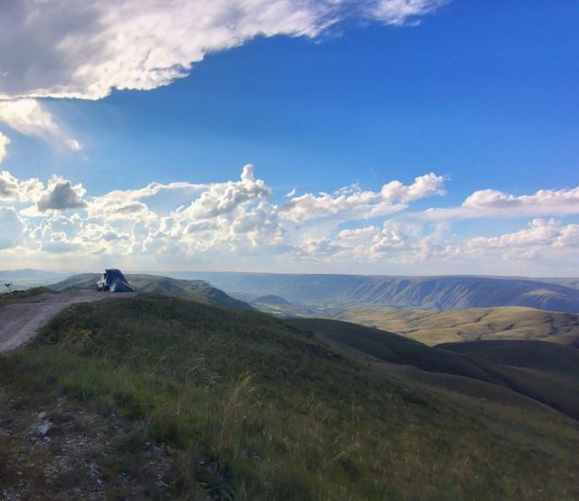](../../assets/img/canastra/08-estrada-no-chapadao.jpg "Estrada na crista, fim de tarde")

!!! warning "Antes de encarar"
    Com chuva, os trechos de terra e erosão mudam completamente — o que é pedra solta no seco vira lama e valeta. Pergunte em São Roque sobre as condições do dia, **não vá sozinho** e leve equipamento de resgate (cinta, manilhas, pá, compressor).

## Nascente do São Francisco, Rasga Canga e Casca d'Anta

A **nascente do Velho Chico** fica dentro do parque, a cerca de **4 km da Portaria 1**, no caminho para a parte alta da Casca d'Anta. É uma nascente **difusa**: não tem um "olho d'água", a água brota devagar do solo encharcado. Por isso a área é frágil — fique na trilha delimitada e leve o lixo de volta.

Perto dali, uma placa indica a **Cachoeira Rasga Canga** a 200 m — uma escadaria de quedas sobre pedra avermelhada. E, de baixo, a **Casca d'Anta** aparece no paredão: são **186 m** de queda, a segunda maior de Minas.

<video class="video-roteiro video-vertical" controls muted loop playsinline preload="metadata" poster="../../../assets/img/canastra/vale-poster.jpg">
  <source src="../../../assets/img/canastra/vale.mp4" type="video/mp4">
</video>
*O vale visto da estrada, na beira do precipício (vídeo sem som).*

!!! info "Parque Nacional"
    O parque abre **todos os dias, das 8h às 18h** (na Casca d'Anta, a entrada vai até as 16h). Leve **dinheiro**: em alguns pontos não há sinal para pagar com cartão ou Pix. Confirme regras e horários com o ICMBio antes de ir.

## Banheiro químico: o item que salvou a viagem

Levamos um **banheiro químico portátil** (NTK Ecocamp) no porta-malas da TeRez4 — e ele **funcionou perfeitamente e foi essencial**. Na Canastra as distâncias são grandes, o chapadão é aberto, sem mato para se esconder, e banheiro só nas portarias e nas vilas.

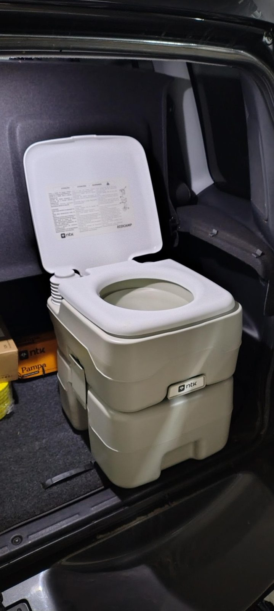{ width="320" }

- **Use o aditivo próprio** no tanque de baixo — ele controla o cheiro e decompõe os dejetos.
- **Esvazie só em local adequado**: ponto de descarte do camping ou vaso sanitário. **Nunca na natureza** — e jamais perto de nascentes e rios.
- Prenda bem no porta-malas: em trecho de pedra ele **pula**. Uma cinta de catraca resolve.
- Leve papel higiênico, saco de lixo e álcool em gel junto.
- Com crianças no carro, faz ainda mais diferença.

## Plano de comunicação

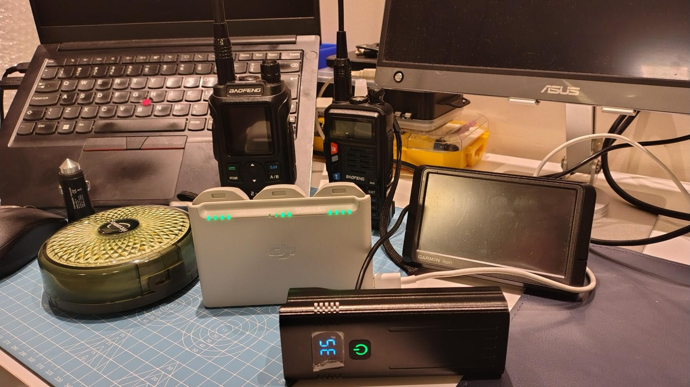{ width="480" }

*O kit: dois HTs, GPS dedicado, power bank e carregador veicular.*

O celular **cai em boa parte do chapadão e das serras**. Em comboio, o rádio é o que mantém o grupo junto.

### 1. Comboio — simplex

- Combine uma frequência **simplex** de comboio antes de sair de São Roque.
- Em subida de pedra, **um carro de cada vez**: quem já subiu avisa "livre" pelo rádio, e só então o próximo vai.
- Use alguém a pé com o HT para **guiar a linha** em erosões e degraus.
- Na poeira, o último carro informa quando perde o da frente de vista.
- Nos cortes de rocha o sinal cai rápido — reagrupe nos **pontos altos e abertos**.

### 2. Apoio — repetidoras

A região tem pouca repetidora cadastrada. As que encontrei ficam a leste, para o lado de Piumhi e Formiga:

| Saída (RX) | Offset | Tom | Repetidora | Indicativo | Dist. de São Roque |
|---|---|---|---|---|---|
| **145.450** | −0,6 | CTCSS 118.8 | Formiga (Morro da Melancia) | `PY4RFR` | ≈ 100 km · leste |
| **147.980** ou **147.380** | ±0,6 · a confirmar | — | Piumhi | `PY4RPI` | ≈ 50 km · leste |

As fontes divergem sobre a frequência de Piumhi, por isso deixei as duas: **teste e me conte qual abre**. Chance real só **do alto do chapadão**, com visada para o leste.

Colegas PY4 da Canastra: se conhecem repetidoras em São Roque, Vargem Bonita, Delfinópolis ou Passos, **ajudem a completar a lista**.

### 3. Emergência

1. **Bombeiros: 193** · SAMU: 192 · Polícia: 190.
2. No parque, procure a **portaria do ICMBio** mais próxima.
3. Sem celular, suba para o ponto mais alto e aberto e chame no rádio — **simplex do comboio** primeiro, depois as repetidoras.
4. Informe: quem, onde (coordenada do GPS), o que aconteceu e quantas pessoas.

## Teste de rádio

| Ponto | Repetidora / contato | Abriu? | Observação |
|---|---|---|---|
| Chapadão (parte alta do parque) | 145.450 Formiga | — | *a registrar* |
| Chapadão | Piumhi (147.380 / 147.980) | — | *a registrar* |
| Subida do Caminho do Céu | Simplex entre carros | — | *a registrar* |
| Serra Branca | Simplex entre carros | — | *a registrar* |

## Antes de ir

- [ ] Previsão do tempo — com chuva, os trechos 4x4 mudam de nível
- [ ] Tanque cheio em São Roque de Minas (posto é raro na serra)
- [ ] Pneus de uso misto, calibrador/compressor e estepe em ordem
- [ ] Kit de resgate: cinta, manilhas, pá, luvas
- [ ] Rádio programado, frequência do comboio combinada
- [ ] Banheiro químico com aditivo, papel e sacos de lixo
- [ ] Dinheiro para o parque e para as vilas
- [ ] Água e lanche — as distâncias entre pontos de apoio são grandes

## Galeria

[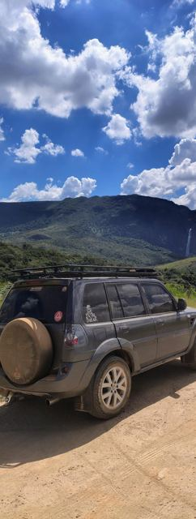](../../assets/img/canastra/02-terez4-casca-danta.jpg "A TeRez4 e a Casca d'Anta ao fundo")
[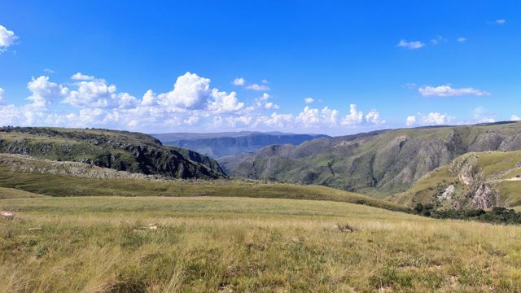](../../assets/img/canastra/03-canion.jpg "Cânion visto do chapadão")

[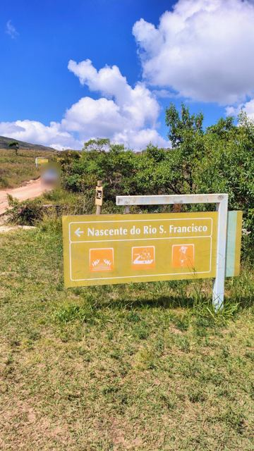](../../assets/img/canastra/05-placa-nascente.jpg "Placa: Nascente do Rio São Francisco")
[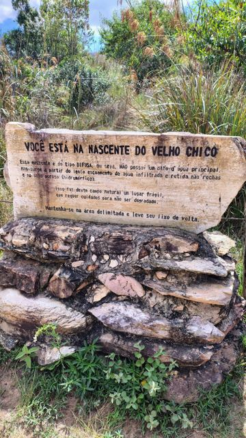](../../assets/img/canastra/06-nascente-velho-chico.jpg "Você está na nascente do Velho Chico")
[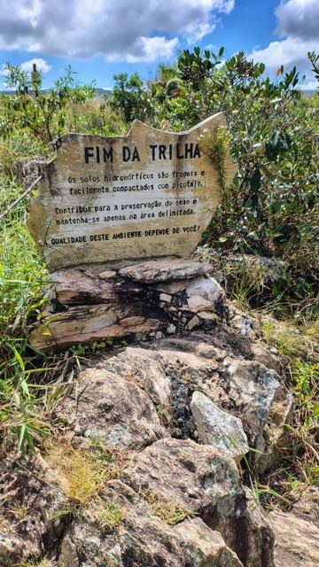](../../assets/img/canastra/07-fim-da-trilha.jpg "Fim da trilha: solo frágil")

[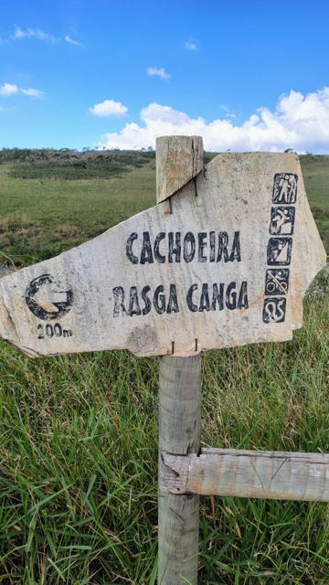](../../assets/img/canastra/09-placa-rasga-canga.jpg "Placa: Cachoeira Rasga Canga, 200 m")
[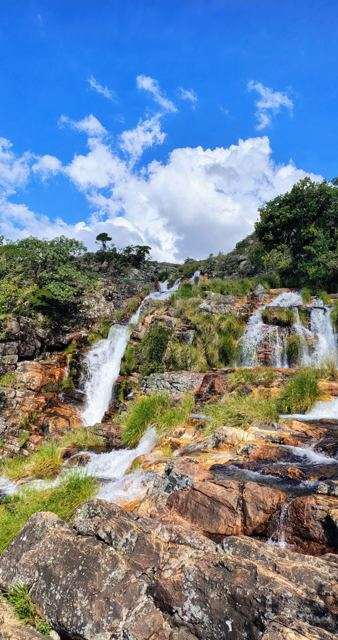](../../assets/img/canastra/10-cachoeira.jpg "Quedas sobre pedra avermelhada")

[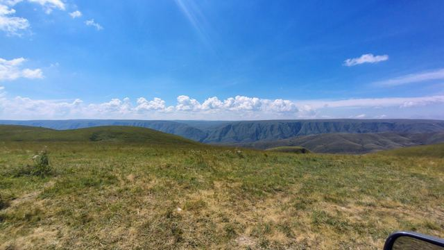](../../assets/img/canastra/12-chapadao.jpg "O chapadão e os paredões ao fundo")
[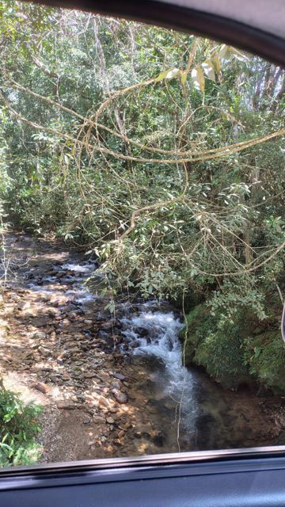](../../assets/img/canastra/13-riacho.jpg "Riacho visto da janela")
[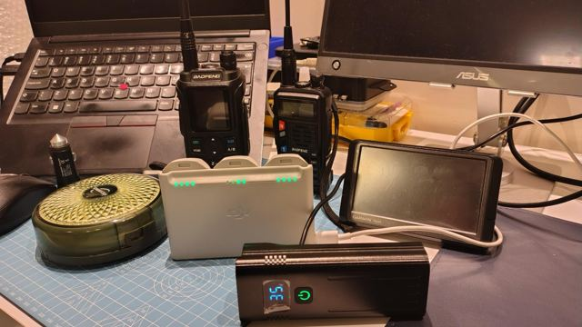](../../assets/img/canastra/14-kit-radio.jpg "O kit de rádio e navegação")
[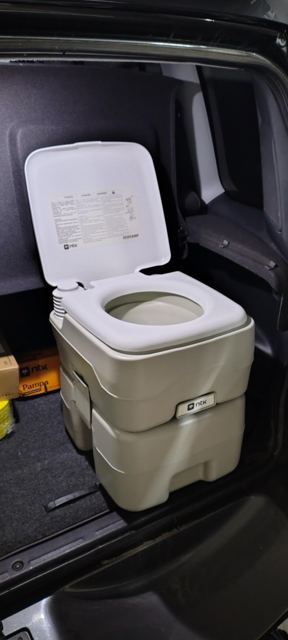](../../assets/img/canastra/15-banheiro-quimico.jpg "O banheiro químico no porta-malas")

*Toque em uma foto para ver em tamanho grande.*

## Referências

- [General Tire — Caminho do Céu na Serra da Canastra](https://www.generaltire.com.br/car/mundo-generaltire/expedicao-generaltire/trilha-offroad-4x4-caminho-do-ceu-serra-da-canastra/)
- [Rotas da Serra da Canastra — atrativos de Delfinópolis](https://www.rotasdaserradacanastra.com.br/atrativos_passeios_delfinopolis.html)
- [Viagens e Caminhos — Serra da Canastra: dicas e roteiro](https://www.viagensecaminhos.com/serra-da-canastra/)
- [PY4SM — repetidoras de Minas Gerais](https://www.qsl.net/py4sm/repetidoras.htm)
- [Ondas do Rádio — repetidoras de MG](http://ondasdoradiodx.blogspot.com/p/repetidoras-do-estado-de-minas-gerais.html)
