# Serra do Corvo Branco · Urubici/SC

{ .capa-roteiro }

A serra que já foi chamada de "a mais temível do Brasil": curvas de até 180 graus, estrada de terra encravada em paredões e o **maior corte de rocha do país, com cerca de 90 m de altura**. Liga Urubici, na serra catarinense, a Grão-Pará, no litoral sul — e fica a uns 40 km da [Serra do Rio do Rastro](serra-do-rio-do-rastro.md), o que faz das duas um roteiro só.

| | |
|---|---|
| **Estrada** | SC-370 · entre Urubici e Grão-Pará/SC |
| **Extensão da serra** | ≈ 4,2 km de curvas acentuadas (até 180°) |
| **Destaque** | Corte na rocha de ≈ 90 m de altura — o maior do Brasil |
| **Distância de Osasco** | ≈ 565 km em linha reta |
| **Distância do Rio do Rastro** | ≈ 41 km em linha reta (mirante a mirante) |
| **Situação em out/2026** | **Em obras de pavimentação** — confirme antes de ir (abaixo) |

!!! danger "Situação atual da estrada"
    Visitei a serra quando ela estava **fechada para obras**, com bloqueio por **risco de deslizamento de rochas** — dava para chegar de carro até o corte, mas não seguir. As obras de pavimentação começaram em março de 2025 (mais de R$ 50 milhões, pela Secretaria de Estado da Infraestrutura — SIE). A reabertura parcial, prevista para julho de 2026, foi **adiada sem nova data** em agosto de 2026, e a conclusão era esperada para o fim de 2026.

    **Antes de ir, confirme com a SIE/SC ou a Polícia Militar Rodoviária (198)** se a serra está aberta, em que horários e para quais veículos.

<video class="video-roteiro" controls muted loop playsinline preload="metadata" poster="../../assets/img/corvo-branco/nuvens-poster.jpg">
  <source src="../../assets/img/corvo-branco/nuvens.mp4" type="video/mp4">
</video>
*As nuvens subindo pela encosta, vistas do alto da serra (vídeo sem som).*

## A estrada

A placa no mirante resume: a Serra do Corvo Branco fica na **BR-370** (como diz a placa; hoje citada como SC-370), entre Urubici e Grão-Pará; **foi a primeira a ligar a serra ao litoral**; tem **4,2 km** e é conhecida pelas curvas acentuadas, que podem chegar a **180 graus**. O ponto mais famoso é a **fenda**: a estrada passa por um corte de cerca de 90 m entre dois paredões de pedra.

Quando eu fui, a estrada ainda era de **terra e cascalho**, com trechos cortados na encosta vermelha e pedras soltas na pista. Com a pavimentação, a experiência vai mudar — mas a paisagem continua a mesma.

## O espectro de Brocken

No mirante, com as nuvens subindo pela encosta e o sol nas costas, presenciei um fenômeno raro: o **espectro de Brocken** — a sombra do observador projetada na neblina, cercada por um halo com as cores do arco-íris. Acontece quando você fica **entre o sol e uma nuvem** logo abaixo: a luz é refletida e difratada pelas gotículas. A serra, com neblina subindo do vale e sol forte em cima, é um dos lugares onde isso pode acontecer — fique atento ao sol baixo e à neblina no paredão.

## No alto: Urubici

Urubici é a base para conhecer a região: frio de serra, campos de altitude, araucárias e mirantes. Há uma **trilha de cascalho** curta até o mirante sobre o vale, com vista do caminho que desce para o litoral.

!!! tip "Combine com o Rio do Rastro"
    Corvo Branco e [Rio do Rastro](serra-do-rio-do-rastro.md) ficam perto e formam um circuito clássico da serra catarinense: subir por uma e descer pela outra (quando o Corvo Branco estiver aberto).

## Plano de comunicação

Serra encravada em paredões, com neblina frequente — **rádio de comboio é essencial**, e o apoio por repetidora é limitado.

### 1. Comboio — simplex

- No corte e nas curvas fechadas, **os paredões bloqueiam o sinal** — mantenha distância curta entre os carros.
- Com neblina, **avise pelo rádio** antes de cada curva cega e ao parar.
- Combine um ponto de reagrupamento **antes do corte** e outro **depois da descida**.

### 2. Apoio — repetidoras

A base de SC do site ainda é pequena, e não há repetidora cadastrada em Urubici, Orleans ou Grão-Pará. As mais próximas ficam na planície do sul catarinense:

| Saída (RX) | Offset | Tom | Repetidora | Indicativo | Dist. |
|---|---|---|---|---|---|
| **145.410** | −0,6 | Sem tom | Urussanga | `PP5CVU` | ≈ 53 km · sul |
| **146.760** | −0,6 | CTCSS 88.5 | Pescaria Brava | `PP5CTE` | ≈ 63 km · sudeste |
| **145.210** | −0,6 | Sem tom | Criciúma | `PP5ARC` | ≈ 70 km · sul |

**Chances só do alto da serra**, com visada para a planície — dentro do corte, esqueça.

Colegas PP5 da região: se conhecem repetidoras em Urubici, São Joaquim ou Lages, **ajudem a completar a lista**.

### 3. Emergência

1. **PMRv: 198** · Bombeiros: 193 · SAMU: 192.
2. No mirante e no alto o celular pode funcionar; no corte e nas curvas, dificilmente.
3. Pelo rádio, chame **do ponto mais alto e aberto** que conseguir.
4. Em obras, a área tem equipes da SIE — eles podem ser o contato mais próximo.

### Desafio: Corvo Branco ↔ Rio do Rastro

Os dois mirantes estão a **≈ 41 km** um do outro, ambos acima de 1.400 m. Com um carro em cada mirante, antenas no teto e 25–50 W em VHF, o QSO em simplex é um ótimo teste.

## Teste de rádio

| Ponto | Repetidora / contato | Abriu? | Observação |
|---|---|---|---|
| Mirante (alto da serra) | 145.410 Urussanga | — | *a registrar* |
| Mirante | 146.760 Pescaria Brava | — | *a registrar* |
| Dentro do corte | Simplex entre carros | — | *a registrar* |
| Mirante ↔ Rio do Rastro | Simplex | — | *a registrar* |

## Antes de ir

- [ ] **Situação da serra:** aberta? horários? (SIE/SC · PMRv 198)
- [ ] Previsão do tempo — neblina e chuva aumentam o risco de queda de rochas
- [ ] Agasalho: a serra catarinense é fria o ano todo
- [ ] Tanque cheio em Urubici ou Grão-Pará
- [ ] Rádio programado e combinado com o comboio
- [ ] Não pare embaixo de paredões com sinais de deslizamento

## Galeria

[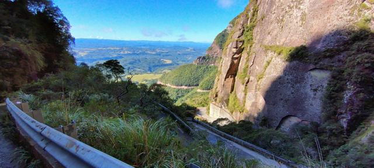](../../assets/img/corvo-branco/01-corte-e-vale.jpg "O corte na rocha e o vale")
[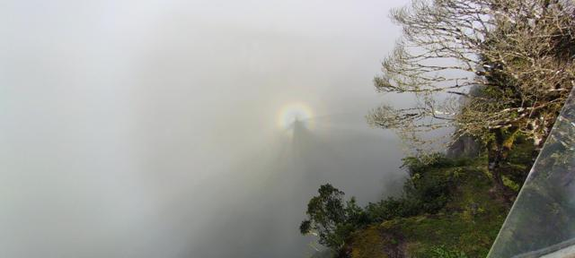](../../assets/img/corvo-branco/02-espectro-de-brocken.jpg "O espectro de Brocken na neblina")
[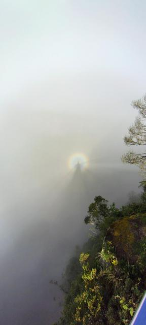](../../assets/img/corvo-branco/03-espectro-vertical.jpg "Sombra e halo na neblina")
[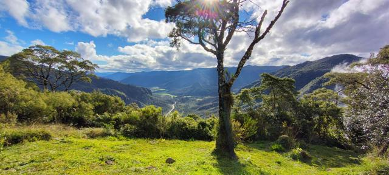](../../assets/img/corvo-branco/04-mirante-vale.jpg "O vale visto do mirante")
[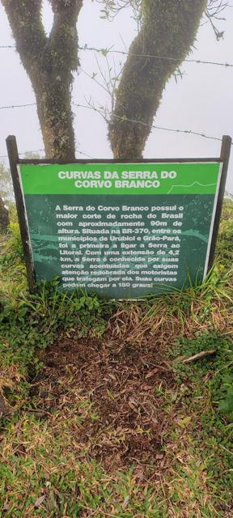](../../assets/img/corvo-branco/05-placa-curvas.jpg "Placa: Curvas da Serra do Corvo Branco")
[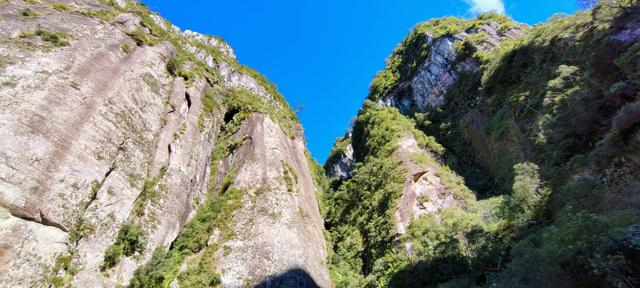](../../assets/img/corvo-branco/06-paredoes.jpg "Os paredões do corte")
[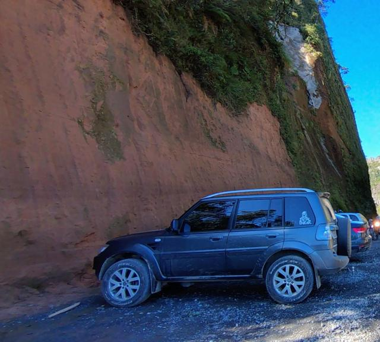](../../assets/img/corvo-branco/11-terez4-na-fenda.jpg "A TeRez4 junto ao corte")
[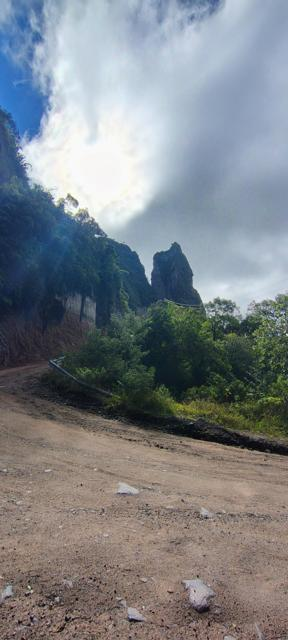](../../assets/img/corvo-branco/07-curva-de-terra.jpg "Curva de terra e o pico de pedra")
[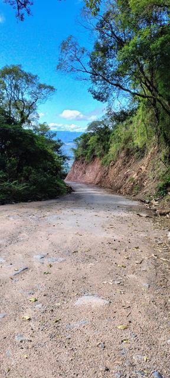](../../assets/img/corvo-branco/08-estrada-no-corte.jpg "A estrada cortada na encosta")
[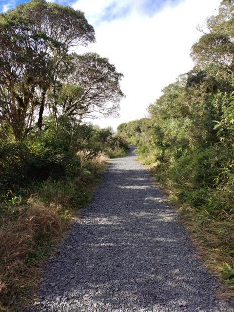](../../assets/img/corvo-branco/09-trilha-mirante.jpg "Trilha de cascalho até o mirante")
[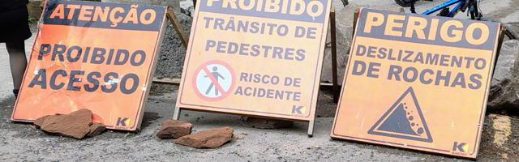](../../assets/img/corvo-branco/10-interdicao.jpg "Bloqueio na época das obras: risco de deslizamento")

*Toque em uma foto para ver em tamanho grande.*

## Referências

- [NSC Total — reabertura adiada sem prazo (ago/2026)](https://www.nsctotal.com.br/infraestrutura/serra-que-ja-foi-a-mais-temivel-do-brasil-segue-sem-prazo-para-liberacao-e-obra-de-r-50-milhoes-continua)
- [São Joaquim Online — tráfego parcial previsto (jul/2026)](https://saojoaquimonline.com.br/noticias/2026/07/17/serra-do-corvo-branco-tera-trafego-parcial-liberado-ainda-em-julho/)
- [4oito — previsão das obras (abr/2026)](https://www.4oito.com.br/noticia/serra-do-corvo-branco-vai-reabrir-em-julho-veja-a-previsao-e-quando-a-obra-termina-86382)
