# Serra do Rio do Rastro · Santa Catarina — SC-390

{ .capa-roteiro }

A estrada mais sinuosa do Brasil: **cerca de 24 km e 284 curvas** ligando Lauro Müller, na planície, a Bom Jardim da Serra, no planalto, subindo de uns 200 m a **≈ 1.460 m**. Foi o roteiro mais longe da TeRez4 até aqui: ≈ 600 km em linha reta de Osasco, com camping, mirantes e muito frio na serra catarinense.

| | |
|---|---|
| **Estrada** | SC-390 (antiga SC-438) — Lauro Müller ↔ Bom Jardim da Serra/SC |
| **Extensão da serra** | ≈ 24 km · 284 curvas |
| **Altitude** | de ≈ 200 m (Lauro Müller) a ≈ 1.460 m (mirante) |
| **Distância de Osasco** | ≈ 606 km em linha reta |
| **Velocidade na serra** | 40 km/h |
| **Pavimento** | Asfalto e concreto — não exige 4x4 |
| **Melhor visibilidade** | Entre 11h e 15h, em dias limpos |
| **Antes de subir** | Situação da serra: **PMRv 198** · há câmeras ao vivo |

<video class="video-roteiro" controls muted loop playsinline preload="metadata" poster="../../../assets/img/rio-do-rastro/mirante-poster.jpg">
  <source src="../../../assets/img/rio-do-rastro/mirante.mp4" type="video/mp4">
</video>
*Do mirante, no alto da serra (vídeo sem som).*

!!! danger "Neblina, gelo e pedras"
    A serra fecha por **neblina** em minutos, por **gelo** no inverno e por **queda de rochas** — em junho de 2025 ficou interditada por gelo e, em julho de 2026, por um desmoronamento perto da gruta. **Confira a situação antes de sair** e, com neblina, reduza a velocidade, aumente a distância e use farol baixo ou de neblina (nunca o alto).

## A estrada

A serra começou como **trilha de tropeiros**, virou estrada de terra nos anos 1950 e foi pavimentada em concreto nos anos 1980 — escolhido justamente pela aderência com gelo. No mirante, uma placa marca a inauguração da **rodovia SC-438, trecho Lauro Müller – Alto da Serra do Rio do Rastro, em 8 de março de 1987**; hoje a estrada é a SC-390. Outra placa registra a **recuperação e modernização da iluminação da serra, em dezembro de 2022** — à noite, as curvas iluminadas são um espetáculo à parte.

**Dicas de direção:**

- Na descida, **use o freio motor** (marcha reduzida); frear o tempo todo superaquece os freios.
- Abasteça **embaixo**, antes de subir.
- Evite fins de semana e feriados: o mirante lota e a fila atrás de ônibus e caminhões é lenta.
- Faça os dois sentidos — subir e descer mostram serras diferentes.

## No alto: Bom Jardim da Serra

- **Mirante da Serra** (≈ 1.460 m): a parada clássica. Em dia limpo, a vista alcança a planície até o litoral.
- **Cânion da Ronda**: a poucos quilômetros do início da serra, perto do parque eólico — as torres de vento no meio do campo de altitude rendem fotos incríveis.
- **Tenda da Lili**, em Bom Jardim da Serra: parada para produtos da serra.
- **[Serra do Corvo Branco](serra-do-corvo-branco.md)**, a ≈ 40 km, perto de Urubici — o outro clássico da serra catarinense.
- Leve **agasalho mesmo no verão** — no alto faz frio, e no inverno pode gear e até nevar.

## Embaixo: os mirantes do pé da serra

No caminho, na planície, há mirantes com a serra inteira no horizonte, esculturas de ferro — como o ciclista e a bicicleta antiga — e o monumento da **Rota Biker**, com o "Rider's Passport" para carimbar.

## O camping

Ficamos acampados com a TeRez4 ao lado da barraca, numa **área coberta por tenda** — ótima para o frio e a garoa da serra — com gramado, chão de pedrisco e a serra ao fundo. À noite, o caminho iluminado entre as palmeiras.

!!! tip "Camping na serra catarinense"
    Mesmo com área coberta, a noite em altitude é fria e úmida: saco de dormir para baixa temperatura, isolante térmico e lona embaixo da barraca fazem toda a diferença. Veja outros campings da região em [Campings próximos](../../camping/campings.md) — escolha **Serra do Rio do Rastro (SC)**.

## Plano de comunicação

A serra tem dois mundos de rádio: **o alto**, aberto para a planície e o litoral, e **as curvas**, encaixadas no paredão, onde o sinal some.

### 1. Comboio — simplex

- Na subida e na descida, o simplex entre carros próximos funciona, mas **as curvas fechadas do paredão cortam o sinal** por alguns instantes.
- **Com neblina, o rádio vale ouro:** avise carro parado, veículo grande vindo e o ponto exato onde você está ("curva da cascata", "mirante").
- Combine um **ponto de reagrupamento** no alto (o mirante) e outro embaixo.

### 2. Apoio — repetidoras

Calculadas a partir do mirante (linha reta). A base de SC do site ainda é pequena — **contribuições de colegas PP5 são bem-vindas**:

| Saída (RX) | Offset | Tom | Repetidora | Indicativo | Dist. · rumo |
|---|---|---|---|---|---|
| **145.410** | −0,6 | Sem tom | Urussanga | `PP5CVU` | ≈ 27 km · sudeste |
| **145.210** | −0,6 | Sem tom | Criciúma | `PP5ARC` | ≈ 37 km · sudeste |
| **145.490** | −0,6 | CTCSS 88.5 | Araranguá | `PP5ARA` | ≈ 62 km · sul |
| **146.760** | −0,6 | CTCSS 88.5 | Pescaria Brava | `PP5CTE` | ≈ 66 km · leste |

Lista completa: [Repetidoras da região](../../radioamador/repetidoras.md) — escolha **Serra do Rio do Rastro (SC)** ou use sua localização.

!!! tip "Do mirante, a planície inteira"
    A 1.460 m, com a planície de Lauro Müller, Urussanga e Criciúma lá embaixo, o mirante é o melhor ponto do roteiro para abrir repetidoras e fazer contatos em simplex com quem está no pé da serra.

### 3. Emergência

1. **PMRv: 198** · Bombeiros: 193 · SAMU: 192.
2. No alto e no mirante o celular costuma funcionar; nas curvas do paredão, nem sempre.
3. Pelo rádio, chame a partir do **ponto mais aberto** que conseguir alcançar — o mirante ou um dos recuos com vista para a planície.
4. Diga onde está com referências da estrada: mirante, gruta, cascata, início da serra.

## Teste de rádio

| Ponto | Repetidora / contato | Abriu? | Observação |
|---|---|---|---|
| Mirante (≈ 1.460 m) | 145.410 Urussanga | — | *a registrar* |
| Mirante | 145.210 Criciúma | — | *a registrar* |
| Meio da serra (curvas) | Simplex entre carros | — | *a registrar* |
| Lauro Müller (base) | Simplex com o mirante | — | *a registrar* |

## Antes de ir

- [ ] Situação da serra (**PMRv 198**) e previsão: neblina, chuva forte e gelo fecham a estrada
- [ ] Freios revisados — a descida é longa
- [ ] Tanque cheio antes de subir
- [ ] Agasalho, gorro e luvas, mesmo no verão
- [ ] Saco de dormir para frio, se for acampar
- [ ] Rádio programado com as repetidoras da região
- [ ] Prefira dias de semana e o meio do dia para visibilidade

## Galeria

[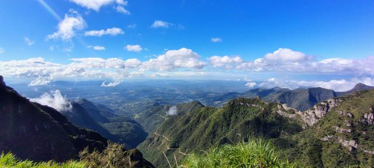](../../assets/img/rio-do-rastro/01-serra-panorama.jpg "A serra vista do alto")
[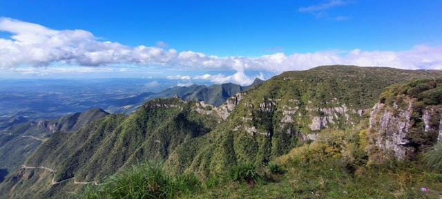](../../assets/img/rio-do-rastro/02-paredoes-e-estrada.jpg "Os paredões e a estrada serpenteando")
[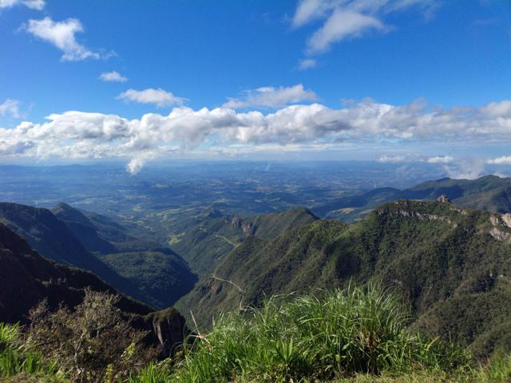](../../assets/img/rio-do-rastro/03-vale-e-curvas.jpg "O vale e as curvas da SC-390")

[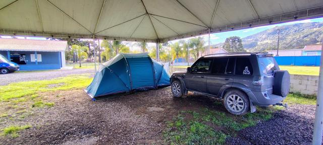](../../assets/img/rio-do-rastro/05-camping-terez4.jpg "Barraca e TeRez4 na área coberta do camping")
[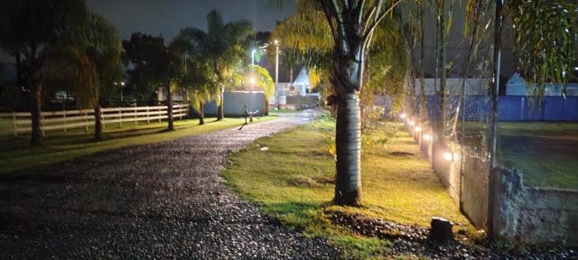](../../assets/img/rio-do-rastro/06-camping-a-noite.jpg "O camping à noite")
[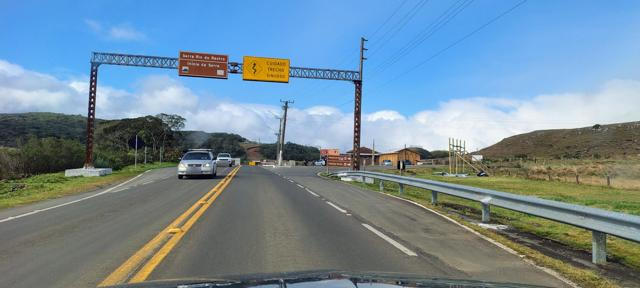](../../assets/img/rio-do-rastro/07-inicio-da-serra.jpg "Início da serra, no alto — acesso ao Cânion da Ronda")
[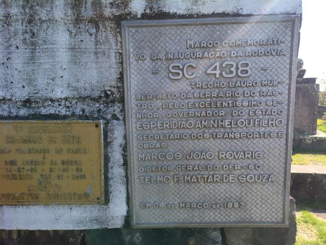](../../assets/img/rio-do-rastro/08-placa-sc438.jpg "Marco da inauguração da SC-438, 1987")
[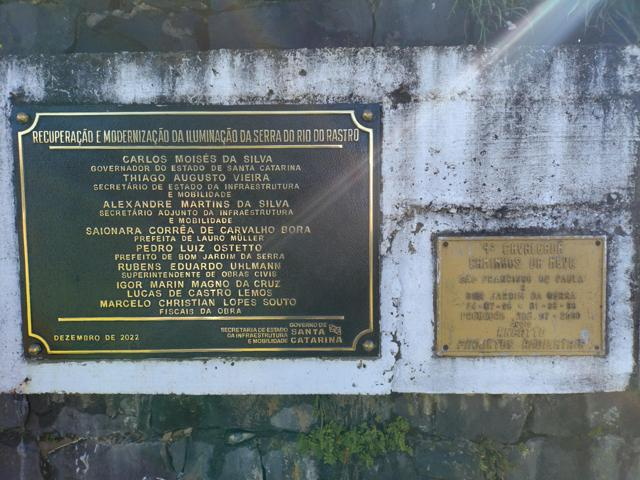](../../assets/img/rio-do-rastro/09-placa-iluminacao.jpg "Modernização da iluminação da serra, 2022")
[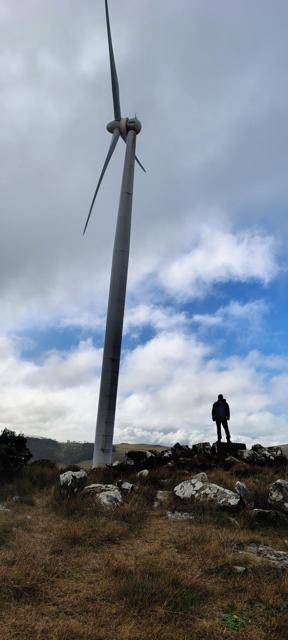](../../assets/img/rio-do-rastro/11-eolica.jpg "Torres eólicas no campo de altitude")
[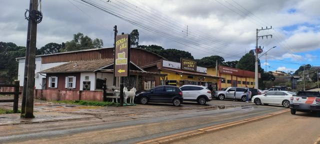](../../assets/img/rio-do-rastro/10-tenda-da-lili.jpg "Tenda da Lili, em Bom Jardim da Serra")
[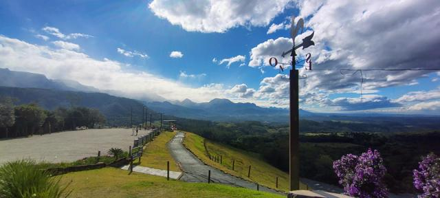](../../assets/img/rio-do-rastro/12-mirante-cata-vento.jpg "Mirante no pé da serra")
[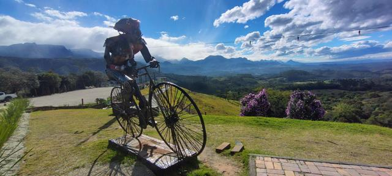](../../assets/img/rio-do-rastro/13-escultura-bicicleta.jpg "A escultura do ciclista e a serra")
[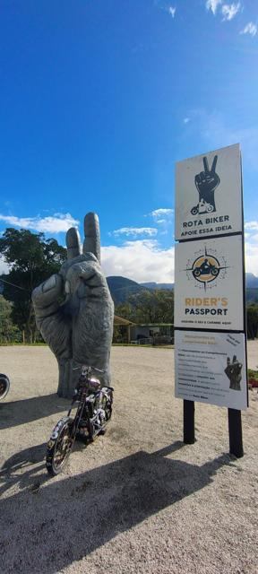](../../assets/img/rio-do-rastro/14-rota-biker.jpg "Monumento da Rota Biker")

*Toque em uma foto para ver em tamanho grande.*

## Referências

- [AutoPapo — Serra do Rio do Rastro: história, engenharia e roteiro (jun/2026)](https://autopapo.com.br/curta/serra-do-rio-do-rastro-a-historia-a-engenharia-e-o-roteiro-da-estrada-mais-sinuosa-do-brasil/)
- [ND Mais — desmoronamento interdita a serra (jul/2026)](https://ndmais.com.br/transito/desmoronamento-interdita-a-serra-do-rio-do-rastro-em-sc/)
- [ND Mais — gelo bloqueia a serra (jun/2025)](https://ndmais.com.br/transito/serra-do-rio-do-rastro-tem-meia-pista-liberada-para-carros-mas-segue-bloqueada-para-caminhoes/)
