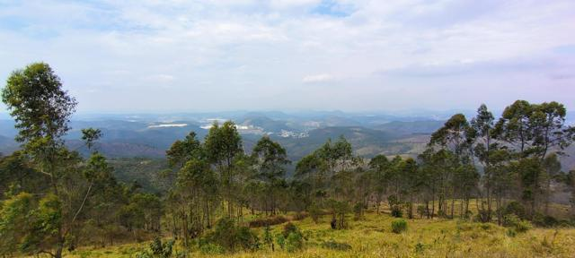
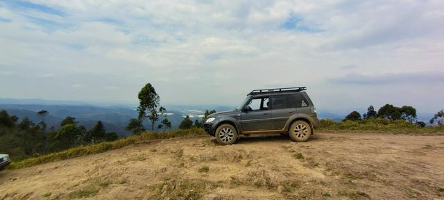
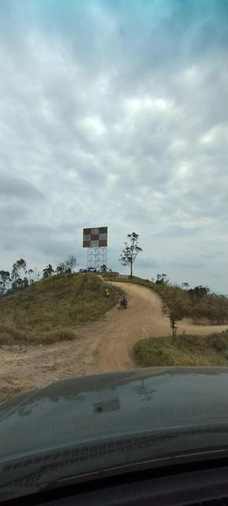
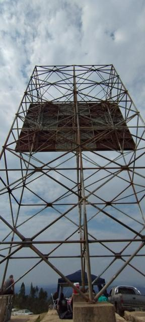
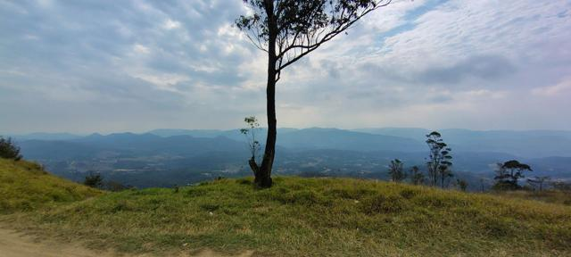
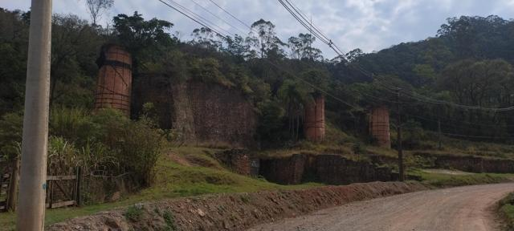
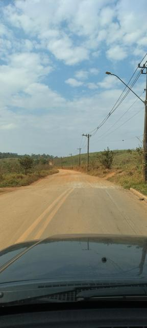
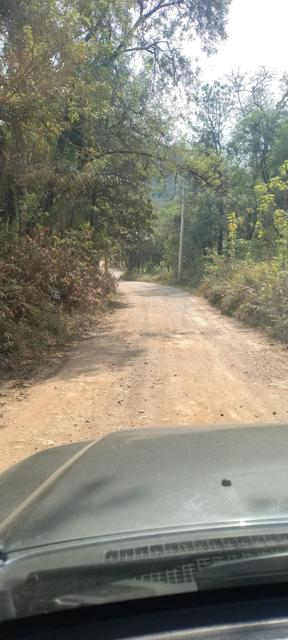
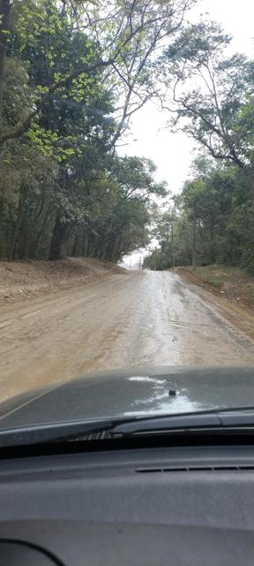
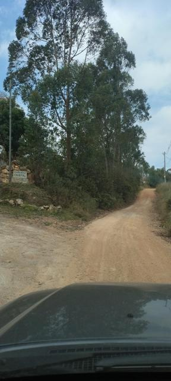

# Trilha da Placa · Cajamar/SP

{ .capa-roteiro }

Subida off-road até o **ponto mais alto de Cajamar**, na Serra dos Cristais, no entorno da Serra do Japi. Lá em cima fica a "Placa", um sinalizador aéreo gigante — e uma das melhores vistas da região. Perto de casa, mas pede carro preparado, grupo e **rádio bem planejado**.

| | |
|---|---|
| **Destino** | Alto da Placa — Serra dos Cristais, Cajamar/SP |
| **Altitude no topo** | ≈ 1.083 m |
| **Distância de Osasco** | ≈ 23 km em linha reta |
| **Nível off-road** | Médio — 100% fora de estrada |
| **Terreno** | Erosões, lama e pedras |
| **Veículo** | 4x4 com reduzida · lift e pneu MT (ou similar) recomendados |
| **Ideal** | Em grupo, na estação seca |

## A Placa

No cume existe uma placa de sinalização aérea de cerca de **25 m de altura por 15 m de largura**, quadriculada em branco e laranja — referência visual para aviões que sobrevoam a região. Do alto dá para ver a serra e as cidades em volta.

Na volta, vale passar pelos **Fornos de Ponunduva**, antigos fornos de cal, patrimônio histórico de Cajamar.

## Plano de comunicação

A trilha sobe e desce por vales: **no fundo do vale o rádio some**, no alto ele vai longe. Por isso o plano tem três camadas.

### 1. Comboio — simplex

Todos os carros na **mesma frequência simplex**, combinada antes de sair (sem offset e sem tom).

- Grupos de trilha da região costumam usar VHF; num evento da Trilha da Placa, por exemplo, o grupo usou **145.500 MHz**.
- **Primeiro e último carro com rádio** — o último avisa quando o comboio está completo após cada obstáculo.
- Chamada pela posição: `Carro 3 para líder`.

### 2. Apoio — repetidoras

Se um carro se separar ou houver emergência, saia do simplex para uma repetidora. Calculadas a partir do topo da serra (linha reta):

| Saída (RX) | Offset | Tom | Repetidora | Indicativo | Dist. do topo |
|---|---|---|---|---|---|
| **147.270** | +0,6 | CTCSS 67.0 | Serra da Cantareira | `PY2KNF` | 25 km |
| **145.270** | −0,6 | CTCSS 123.0 | Cabreúva (lado do Japi) | `PY2KSC` | 29 km |
| **146.610** | −0,6 | CTCSS 123.0 | Itapecerica da Serra · LABRE-SP | `PY2KBX` | 43 km |
| **439.650** | −5 | CTCSS 123.0 | Caieiras | `PY2KPE` | 12 km |
| **438.500** | −5 | CTCSS 74.4 | Jundiaí | `PY2KET` | 16 km |
| **439.050** | −5 | CTCSS 67.0 | Taipas · pé do Pico do Jaraguá | `PY2KRB` | 18 km |

Lista completa e atualizada: [Repetidoras da região](../../radioamador/repetidoras.md) (escolha **Jundiaí** ou **Osasco** e raio de 50 km).

!!! tip "Regra de ouro"
    Programe tudo **antes** de sair: simplex do comboio na memória 1 e as repetidoras de apoio nas seguintes. Na trilha ninguém tem mão livre para mexer em menu.

### 3. Emergência

1. Volte para o **ponto alto mais próximo** antes de chamar — 50 metros de subida mudam tudo.
2. Chame na repetidora de apoio: indicativo, **onde** (referência ou coordenada), **o que aconteceu** e **quantas pessoas**.
3. Sem resposta: tente as outras repetidoras e repita a chamada em intervalos regulares.
4. Celular costuma pegar no topo — use as duas coisas.

## Dicas de rádio na região

### Memórias prontas para o HT

Arquivo para importar no **CHIRP** com o plano completo da trilha: simplex do comboio, as seis repetidoras de apoio (offset e tom já configurados) e o canal de APRS.

[:material-download: Memórias da Trilha da Placa (CHIRP · CSV)](../../assets/arquivos/trilha-da-placa-chirp.csv){ .md-button }

| Mem. | Nome | Frequência | Uso |
|---|---|---|---|
| 1 | COMBOI | 145.500 simplex | Comboio (exemplo; combine com o grupo) |
| 2 | CANTAR | 147.270 +0,6 · 67.0 | Apoio principal |
| 3 | CABREU | 145.270 −0,6 · 123.0 | Apoio pelo lado do Japi |
| 4 | LABRE | 146.610 −0,6 · 123.0 | LABRE-SP |
| 5 | CAIEIR | 439.650 −5 · 123.0 | UHF, mais próxima |
| 6 | JUNDIA | 438.500 −5 · 74.4 | UHF, lado de Jundiaí |
| 7 | APRS | 145.570 | APRS Brasil (só escuta/TNC) |
| 8 | JARAGU | 439.050 −5 · 67.0 | UHF, lado do Jaraguá/SP |

### Para onde a serra "enxerga"

Do Alto da Placa (≈ 1.083 m), as referências de rádio da região, com distância e rumo aproximados:

| Referência | Dist. · rumo | O que esperar |
|---|---|---|
| **[Pico do Jaraguá](pico-do-jaragua.md)** (SP) | ≈ 16 km · Sudeste (≈ 150°) | Visada aberta para a capital; boas chances com repetidoras do lado de SP (ex.: 439.050) |
| **Serra da Cantareira** | ≈ 24 km · Leste (≈ 115°) | Repetidoras altas (147.270 / 147.030); o apoio mais provável |
| **Serra do Japi / Jundiaí** | ≈ 16 km · Noroeste (≈ 320°) | 438.500 e 147.300 (DMR) |
| **Pirapora do Bom Jesus** · vale do Tietê | ≈ 16 km · Sudoeste (≈ 245°) | Vale encaixado: **sombra de rádio** para quem estiver lá embaixo |
| **Osasco** | ≈ 23 km · Sul (≈ 165°) | Dá para tentar simplex com a base em casa, com antena boa nas duas pontas |

!!! tip "Estação de apoio no topo"
    O truque dos comboios experientes: quando o grupo for descer para os vales, **um carro fica no alto** como ponto de retransmissão. Quem está lá embaixo fala com o topo em simplex, e o topo repassa para o resto do grupo ou para a repetidora.

### O relevo manda

- **VHF/UHF é visada direta.** A Serra dos Cristais é cercada por morros; o mesmo rádio que alcança 40 km no topo pode não falar 2 km dentro do vale.
- **No topo, aproveite:** do alto a visada para a Grande SP e para o lado de Jundiaí é aberta. É o melhor ponto da trilha para testar repetidoras distantes.
- **Nos vales e sob mata fechada**, o comboio em simplex pode quebrar. Combine que o **líder espera no próximo ponto alto** até o último carro confirmar.
- **Separou do grupo?** Suba até um ponto mais alto ou mais aberto **antes** de chamar. Poucos metros de altitude valem mais do que potência.

### Equipamento

- **Rádio móvel com antena no teto** rende muito mais do que o HT dentro do carro: a lataria bloqueia o sinal. Com HT, use antena externa (magnética no teto) ou ao menos uma antena melhor que a "borrachinha".
- **UHF passa melhor** entre árvores e construções a curta distância; **VHF vai mais longe** em campo aberto. Ter as duas faixas memorizadas dá opção.
- **Bateria:** em trilha você fala mais que o normal. Leve bateria reserva ou alimentação pelo carro.
- **Galhos baixos:** os trechos sob mata fechada têm galhos na altura do teto. Antena alta no teto precisa ser flexível ou de rebater.
- **Linhas de energia:** boa parte da estrada de terra corre ao lado de postes e fios. Se aparecer chiado constante parado embaixo da rede, ande alguns metros antes de concluir que a repetidora "não abre".

### Comboio com pessoas sem licença

Só radioamadores licenciados podem transmitir nas faixas de radioamador. Se no comboio houver motoristas sem licença, use para o grupo um **rádio de uso livre** (tipo talkabout) e mantenha o VHF de radioamador com quem é licenciado — inclusive para o apoio via repetidora.

### Boas práticas na repetidora

- Identifique-se com o **indicativo** no início e no fim do contato.
- Antes de transmitir, **escute alguns segundos**: a frequência pode estar em uso.
- Na repetidora, seja breve; para conversa longa do grupo, use o simplex.

### Segurança

!!! danger "Raios no topo"
    O Alto da Placa é o ponto mais alto da região e tem uma grande estrutura metálica. **Com tempo fechado e trovoada, desça** e não opere rádio com antena externa no topo.

!!! example "Desafio"
    Daqui até a [Pedra Grande, em Atibaia](pedra-grande.md#desafio-placa-pedra-grande-em-simplex) são ≈ 39 km entre dois pontos altos. Com um carro em cada topo, dá para tentar o QSO em simplex.

## Teste de rádio na trilha

Este é o diferencial do roteiro: um registro do que **realmente abre** em cada ponto. A cada visita, eu atualizo a tabela.

| Ponto | Repetidora testada | Abriu? | Sinal / observação |
|---|---|---|---|
| Saída (Cajamar) | — | — | *a registrar* |
| Meio da subida (vale) | — | — | *a registrar* |
| Alto da Placa | — | — | *a registrar* |
| Fornos de Ponunduva | — | — | *a registrar* |

## Antes de ir

- [ ] **Não vá sozinho** — mínimo de dois carros
- [ ] Cinta de 5 t com manilhas, pá e pranchas
- [ ] Rádio VHF testado e memórias programadas (veja acima)
- [ ] Tanque cheio e água para todos
- [ ] Previsão do tempo: **com chuva, erosão e lama mudam o nível da trilha** — na dúvida, adie
- [ ] Trilha baixada offline (links abaixo)

!!! warning "Respeite a serra"
    A região fica no entorno da Serra do Japi, área de preservação. Fique nas trilhas existentes, não abra caminho novo, não deixe lixo e respeite propriedades e moradores.

## Trilhas GPS e referências

- [Wikiloc — Trilha da Placa (off-road): Placa, Ponunduva, Japi](https://www.wikiloc.com/offroading-trails/trilha-da-placa-cajamar-placa-ponunduva-japi-a-pe-jundiai-8362830)
- [Wikiloc — trilhas off-road em Cajamar](https://www.wikiloc.com/trails/offroading/brazil/sao-paulo/cajamar)
- [Fórum 4x4 Brasil — tópico Trilha da Placa](https://www.4x4brasil.com.br/forum/trilhas/117775-trilha-da-placa-cajamar-2.html)

## Meu relato — com a TeRez4

Subi com a **TeRez4**, minha Pajero TR4, em época seca. O caminho começa no asfalto, que logo termina e vira estrada de terra larga, com trechos sob mata fechada e alguns pontos úmidos mesmo sem chuva — ali o barro já pede atenção. Na bifurcação da **Chácara Cristal** a estrada segue subindo até o topo, onde o terreno vira terra solta e pedra, com erosões nas rampas finais até a Placa.

Lá em cima o visual compensa tudo: de um lado o vale com as cidades, do outro a sequência de serras do Japi. No caminho de volta, parada obrigatória nos **Fornos de Ponunduva**.

!!! note "Dica de quem foi"
    Com tempo seco a subida é tranquila para um 4x4 em ordem. Os trechos molhados sob as árvores são o ponto de atenção: com chuva, eles mudam completamente o nível da trilha.

## Galeria

*Toque em uma foto para ver em tamanho grande.*
