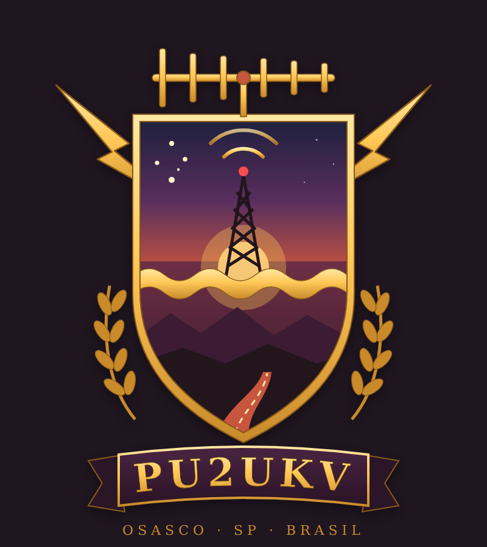

# Sobre

{ width="360" }

Este é o site da estação **PU2UKV**, de Osasco/SP.

Aqui reúno o que uso no dia a dia do rádio e da estrada: tabelas de consulta, guias curtos e checklists. Sem portal, sem enrolação — referência rápida para usar no meio do QSO ou na beira da trilha.

## O brasão

No alto, a antena Yagi faz as vezes de coroa; os raios cruzados representam a radiofrequência. No campo de cima, a torre transmitindo sob o Cruzeiro do Sul; a faixa dourada ondulada é a onda de rádio; embaixo, a serra e a estrada — o lado overland da estação.

[:material-download: Brasão PNG (fundo transparente)](assets/img/brasao.png){ .md-button }
[:material-download: Brasão vetorial (SVG)](assets/img/pu2ukv-brasao.svg){ .md-button }

## Contato

Correções e sugestões são bem-vindas — principalmente sobre repetidoras.

- QRZ: [PU2UKV](https://www.qrz.com/db/PU2UKV)

**73!**
